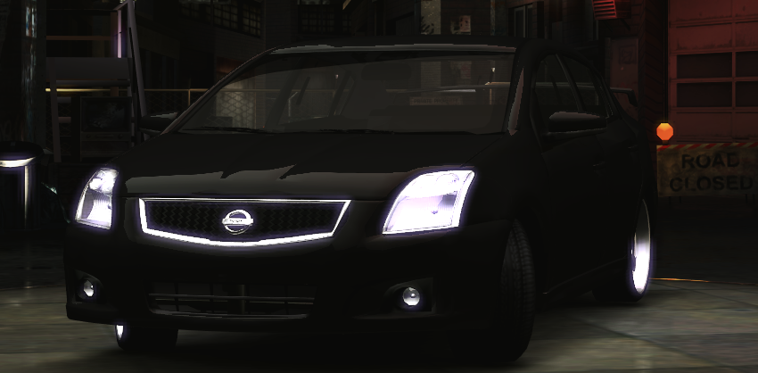
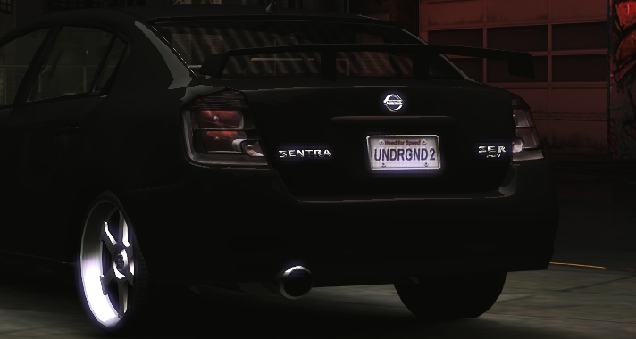
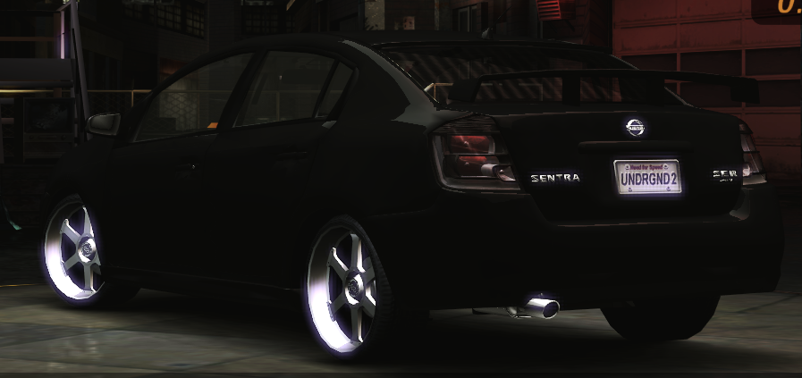
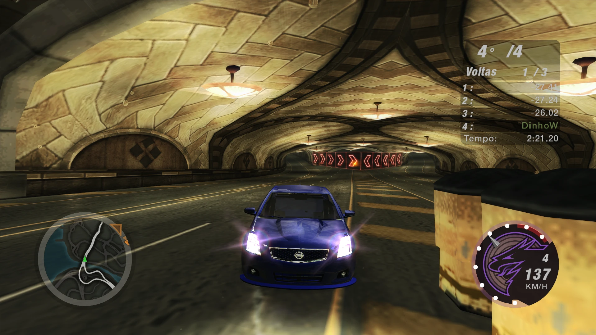
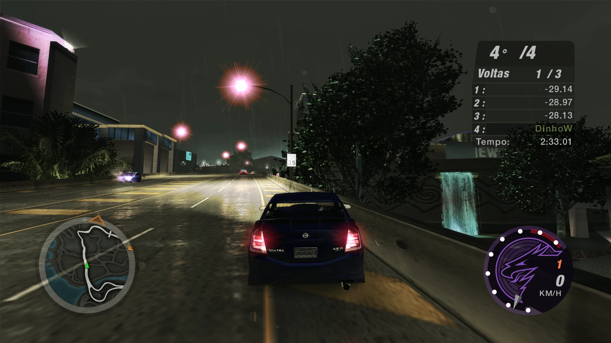
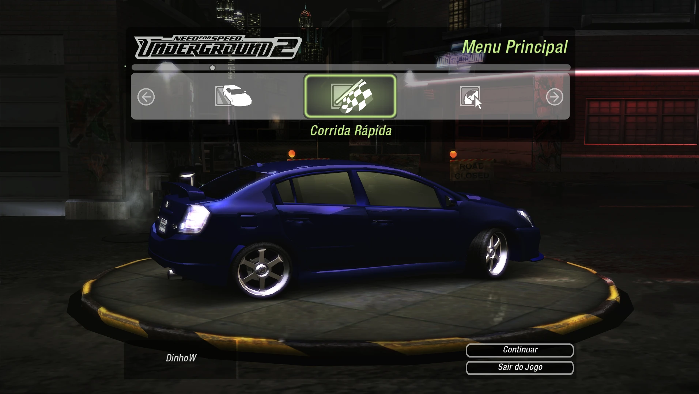
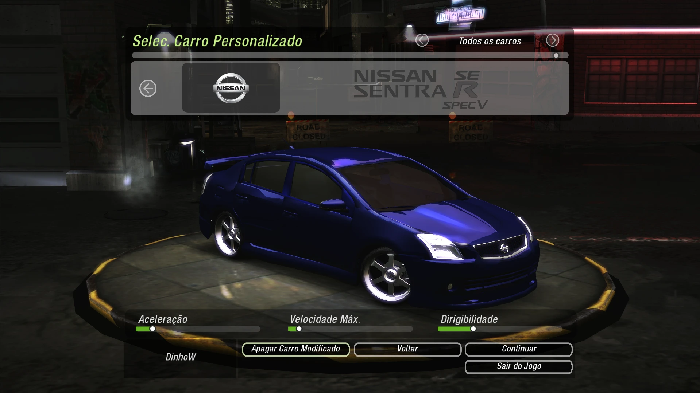

# nfsu2-car-tools: Assetto Corsa → NFSU2 car converter

**Converts Assetto Corsa car mods (`.kn5`) into Need for Speed: Underground 2 (PC) cars**, rebuilding the game's own `GEOMETRY.BIN` and `TEXTURES.BIN`. No ZModeler needed.

The first car converted with it is the **Nissan Sentra SE-R Spec V B16 (2007–2012)**, which replaces the stock B15 Sentra. The project is a **work in progress**, and I'm looking for someone who wants to continue it. *Versão em português abaixo.*

### Why this exists

I own a real Sentra B16 and wanted to drive it in NFSU2. There was no ready-made way to do it, so I built these tools with the help of AI (Claude Opus). This is how I managed to get my car into the game.

**If you want your own car in the game, do what I did:** use these tools, and ask an AI for help with your mod. Most of the hard work here (decoding the file formats, finding out how the game loads textures, fitting the kits) was done that way, step by step, testing in the game.

**Generic parts** (work for any car):
- KN5 reader
- GEOMETRY.BIN and TEXTURES.BIN reader and writer
- JDLZ texture compression
- CarTypeInfo wheel patch
- Kit morphing
- Validation

**Still Sentra-specific** (to be generalized):
- The mesh names used to split the model into parts
- The wheel centers
- The grille region
- The B16 front bumper variants

| | |
|---|---|
|  |  |
|  |  |
|  |  |
|  |  |

> **No game files, car models or textures are included.** You need your own NFSU2 installation and an Assetto Corsa car mod you are allowed to use. The tools generate everything locally on your machine.
> **Respect the mod authors:** only convert models you have the right to use, and don't redistribute the generated car files without the original author's permission.

## What works (tested offline on PC)

- Full B16 body with 3 LODs.
- Paint (color changes), working head and brake lights, fog lights, grille and badges.
- Aftermarket wheels, spoilers, roof scoops and mirrors, with mount points repositioned for the B16.
- 8 B16-based front bumpers: lips, splitters and a blacked-out grille.
- The remaining stock kits, morphed to the B16 shape.
- Wheel positions adjusted for the longer wheelbase (4-value CarTypeInfo patch).

## What's left (help wanted)

- **Vinyl support:** remap the body UVs to the car skin layout. Right now vinyls don't apply.
- **Proper B16 wheels:** the SE-R wheel renders mirrored (see the spoke orientation notes in `docs/FORMAT.md`). For now the stock B15 wheels and brakes are used.
- **STYLE headlights and taillights** still look off.
- **Real bodykits and widebody:** these need proper hand modeling.
- **Collision outlines:** the `CV` records are still the B15 ones.
- **Browser version:** test and adapt for NFSU2 Revived.
- **Generalize the converter for any AC car:**
  - automatic part classification from the mesh names;
  - wheel centers read from the model;
  - a config file per car instead of values in the code.

## How it works

1. **Extract** the source model (`.kn5`, the Assetto Corsa format) to meshes and textures: `tools/kn5_export.py`.
2. **Build the parts in Blender:** convert the axes, split the model into the game's parts (KIT00 and BASE), decimate it into LODs A, B and C, and compute the mount points: `tools/build_nfsu2.py`.
3. **Dump** the Blender scene for the compiler: `tools/dump_blend.py`.
4. **Textures:** put the new textures into stock texture slots that are always loaded, cropped to the UV region actually used: `tools/build_textures.py`.
5. **Compile** `GEOMETRY.BIN`, using the stock file as a template. This step also:
   - maps every material to a stock texture, shader and flags combination;
   - morphs the stock kits to the new shape;
   - adds the B16 front bumper variants.

   Script: `tools/compile_sentra.py` (`tools/kit_morph.py`, `tools/b16_front.py`).
6. **Patch** the wheel positions in CarTypeInfo: `tools/patch_wheels.py`.
7. **Validate** the result: `tools/validate.py`. You can also check the reader and writer with `tools/roundtrip.py`, which must rewrite the stock file byte-identically.
8. **Install** with a backup: `scripts/install.ps1`. Undo with `scripts/restore.ps1`.

The format details are in **[docs/FORMAT.md](docs/FORMAT.md)**.

### Commands

Requirements: Python 3.10+ with `numpy`, `scipy` and `Pillow`, and Blender 4.x.

```
python tools/kn5_export.py <car.kn5> export/sentra
blender -b -P tools/build_nfsu2.py -- <car.kn5> export/sentra/textures nfsu2_build
blender -b nfsu2_build/sentra_nfsu2.blend -P tools/dump_blend.py -- nfsu2_build/mesh_dump.json
python tools/b16_front.py nfsu2_build/mesh_dump.json nfsu2_build/b16_front.json
python tools/build_textures.py "<game>/CARS/SENTRA/TEXTURES.BIN" export/sentra/textures out_game/CARS/SENTRA/TEXTURES.BIN nfsu2_build/mesh_dump.json
python tools/compile_sentra.py "<game>/CARS/SENTRA/GEOMETRY.BIN" nfsu2_build/mesh_dump.json nfsu2_build/build_report.json nfsu2_build/TEXTURES_new_textures.json out_game/CARS/SENTRA/GEOMETRY.BIN --b16front=nfsu2_build/b16_front.json
python tools/patch_wheels.py "<game>/GLOBAL" out_game/GLOBAL 1.3996 -1.2996
python tools/validate.py "<game>" out_game/CARS/SENTRA/GEOMETRY.BIN out_game/CARS/SENTRA/TEXTURES.BIN "<game>/CARS/SENTRA/GEOMETRY.BIN"
powershell -ExecutionPolicy Bypass -File scripts/install.ps1 -Game "<game>"
```

**Performance:** NFSU2 renders on a single thread, so heavy models can cost FPS on weaker PCs. Add `--budget=0.45` to the `build_nfsu2.py` command to get a lighter car with the same look. For the Sentra, LOD A drops from about 51k to 23k triangles and `GEOMETRY.BIN` from 14.3 MB to 9.5 MB.

Always point `GEOMETRY.BIN` and `TEXTURES.BIN` to the **original** files (for example the backup made by `install.ps1`), never to an already modified copy.

Some values in `build_nfsu2.py` and `compile_sentra.py` are specific to the Sentra B16 source model: mesh names, wheel centers and the grille region. To convert another car, adjust those values.

The scripts in `tools/research/` were used to reverse-engineer the formats: chunk walker, part and marker listings, CarTypeInfo dump and render helpers.

Converted with the help of Claude Opus (Anthropic).

---

## Português

**Conversor de mods de carro do Assetto Corsa (`.kn5`) para o NFSU2 de PC.** Ele reconstrói o `GEOMETRY.BIN` e o `TEXTURES.BIN` do próprio jogo, sem ZModeler.

O primeiro carro convertido é o **Nissan Sentra SE-R Spec V B16 (2007–2012)**, no lugar do Sentra B15 original. O projeto está **em andamento**, e procuro alguém que queira continuá-lo.

**Por que isso existe:** eu tenho um Sentra B16 de verdade e quis colocá-lo dentro do NFSU2. Não havia um jeito pronto, então fiz estas ferramentas com auxílio de IA (Claude Opus). Foi a maneira que consegui.

**Quem quiser o próprio carro no jogo, faça como eu:** use as ferramentas e peça auxílio da IA para seus mods. A parte difícil foi feita assim, passo a passo e testando no jogo: decifrar os formatos, descobrir como o jogo carrega as texturas e adaptar os kits.

**Já serve para qualquer carro:**
- leitor de KN5
- leitor e gravador de GEOMETRY.BIN e TEXTURES.BIN
- compressão das texturas
- patch das rodas
- adaptação de kits
- validação

**Ainda é específico do Sentra:**
- separação das peças pelos nomes das malhas
- centros das rodas
- região da grade
- para-choques do B16

**Nenhum arquivo do jogo, modelo ou textura está incluído.** Você precisa do seu NFSU2 e de um mod de carro do AC que tenha direito de usar. As ferramentas geram tudo localmente. Respeite os autores dos mods: não redistribua os arquivos convertidos sem autorização do autor original.

**O que funciona:**
- Carroceria do B16 com 3 níveis de detalhe.
- Pintura, faróis e lanternas acendendo, faróis de milha, grade e emblemas.
- Rodas aftermarket, aerofólios, entrada de ar no teto e retrovisores.
- 8 para-choques dianteiros baseados no B16.
- Demais kits do jogo adaptados ao formato do B16.
- Posição das rodas ajustada para o entre-eixos maior.

**O que falta:**
- Vinis.
- Rodas próprias do B16, que hoje aparecem espelhadas.
- Faróis e lanternas de estilo.
- Body kits modelados à mão.
- Contornos de colisão.
- Testar na versão de navegador (NFSU2 Revived).
- Generalizar para qualquer carro do AC, com classificação automática das peças e um arquivo de configuração por carro.

O passo a passo e os comandos estão na seção em inglês acima. Os detalhes do formato estão em [docs/FORMAT.md](docs/FORMAT.md).

Conversão feita com auxílio do Claude Opus (Anthropic).

## Support / Apoio

If these tools or the format documentation helped you, you can support their development:
[buymeacoffee.com/dinhow](https://buymeacoffee.com/dinhow). Support is for the tools and the research only. No car files are offered in return.

Se as ferramentas ou a documentação te ajudaram, você pode apoiar o desenvolvimento pelo link acima. O apoio é pelas ferramentas e pela pesquisa, sem troca de arquivos de carro.

## License

The code is under the MIT license (see `LICENSE`). Game files, car models and textures belong to their respective owners and are **not** part of this repository.
